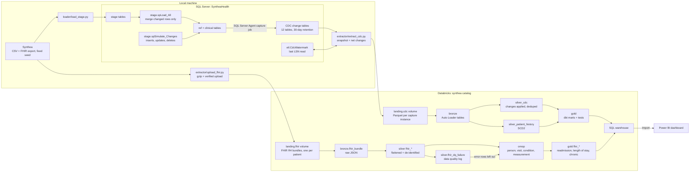
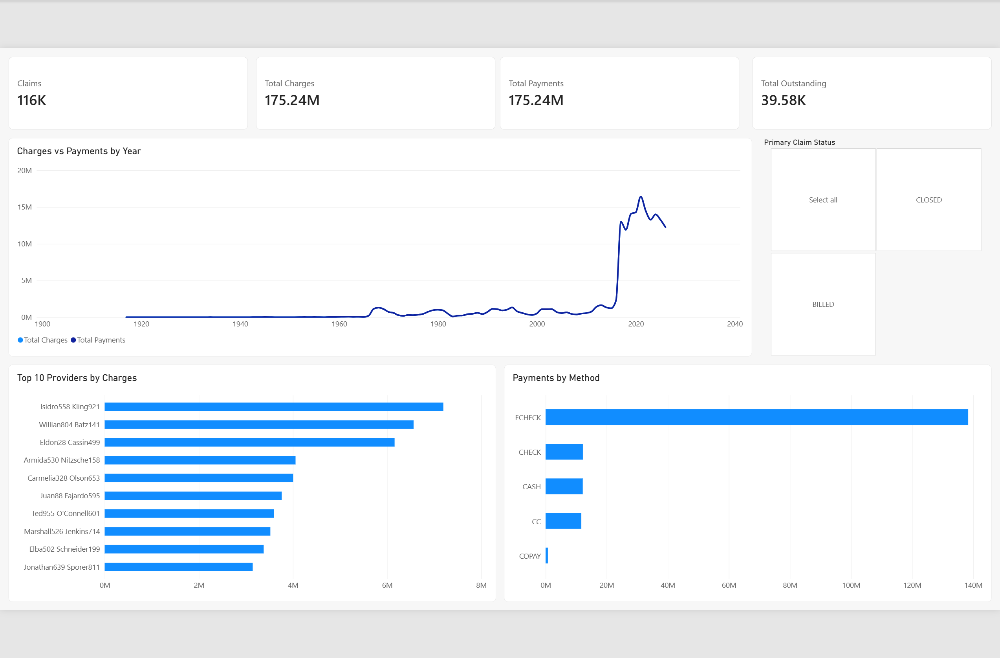
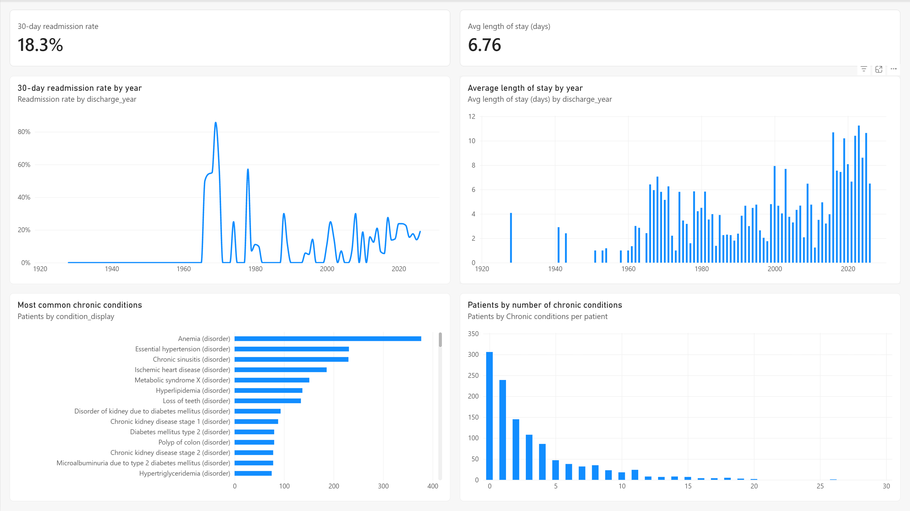

# synthea-health-pipeline

End-to-end healthcare ELT pipeline on synthetic patient data, with two sources. SQL Server is the relational source system, CDC captures every change, Databricks processes it through bronze, silver and gold, and dbt builds the marts. Next to it, a FHIR R4 path lands one JSON bundle per patient, flattens and de-identifies it in PySpark, logs data quality failures, builds OMOP CDM tables and computes clinical quality metrics. Airflow orchestrates both in one run, and Power BI shows the results.


## Pipeline flow



Airflow runs everything above as one DAG of 8 tasks: generate_synthea, then upload_fhir alongside the CDC chain (load_stage, sp_load_all, simulate_changes, extract_cdc), then run_databricks_job and cleanup_local_files. Local CSVs are only deleted after the Databricks job succeeds, so a failed run can be retried. FHIR files are deleted one by one, each only after its upload is verified.


The Databricks part is a bundle-deployed job. The CDC notebooks with dbt and the FHIR notebooks run as two independent branches:


## Stack

- SQL Server: source database, stored procedures, CDC, role-based security, dynamic data masking
- Python: Synthea loader, CDC extractor, FHIR uploader, orchestration scripts
- Databricks (Free Edition, serverless): Unity Catalog, Auto Loader, PySpark, Asset Bundles
- FHIR R4 and OMOP CDM v5.4: healthcare interchange format in, research data model out
- dbt: gold star schema and data tests
- Airflow 3: single container, manual trigger
- Power BI: dashboard on the gold marts and FHIR metrics
- GitHub Actions: CI/CD (validate on every PR, deploy on merge to main)

## SQL Server design

- `stage` holds raw loads. `ref` and `clinical` hold the merged data. Consumers read the `api` views, never the tables.
- `ref.Location` is a hierarchy (state, county, city) with `ID`, `ID_Parent`, `Path`, `Level` and `HasChildren`, kept up to date by `ref.spLocation_UpdateHierarchy`.
- Role-based security: four roles (Developer, Clinician, Loader, Extractor) built on schema grants, each with its own least-privilege login. Dynamic data masking hides patient details, and the extractor can unmask `BirthDate` only, because silver needs it.
- Data minimization: SSN, driver's license and passport numbers are never loaded. There is no stage column for them.
- Merges write only rows that actually changed (`EXISTS ... EXCEPT`), so CDC never logs fake updates.
- CDC is enabled on 12 tables with 30-day retention. The extractor tracks the last LSN it read in `etl.CdcWatermark`, so each run only pulls new changes.
- `stage.spSimulate_Changes` makes random inserts, updates and deletes so every run has real CDC traffic to process.
- No secrets in the repo: passwords and the Databricks token live in user environment variables.

## FHIR and OMOP path

**Source.** Synthea exports one FHIR R4 transaction bundle per patient, limited to the resource types the pipeline uses (Patient, Encounter, Condition, Observation) and saved under UUID file names, so patient names never leave the machine in a file name. `upload_fhir.py` gzips each bundle (JSON shrinks about 10x), uploads it to the `landing.fhir` volume, checks the size, and only then deletes the local file.

**Bronze** (`04_bronze_fhir`). Auto Loader keeps each bundle as one raw text row. Nothing is parsed yet, so a schema surprise never breaks ingestion.

**Silver: flattening and de-identification** (`05_silver_fhir`). Bundles are exploded into one row per resource, and each type is parsed with an explicit schema into `fhir_patient`, `fhir_encounter`, `fhir_condition` and `fhir_observation`. De-identification happens in the same step:
- Patient IDs become a salted SHA-256 hash.
- Names, phone and street address are dropped, and the zip code is cut to 3 digits.
- Every date of a patient moves back by the same 1 to 365 days, so intervals like length of stay and days to readmission stay correct while real dates are hidden.

**Data quality** (`06_dq_fhir`). Every failing row is written to `silver.fhir_dq_failure` with the check name and a severity, instead of being dropped silently. Checks: missing diagnosis codes, encounters, conditions or observations without a matching patient, visits before birth, visits after death, and encounters that end before they start. Two findings from the first run shaped the rules:
- Visits after death were all "Death Certification" encounters: paperwork done after death, not a visit. The check skips that type.
- Some newborns had their first well-child visit exactly one day before the birth date. Birth is stored as a date only and visits have a time and timezone, so this is a date boundary quirk of the source. It is logged as a warning; more than one day before birth is still an error.

**OMOP CDM v5.4** (`07_omop_fhir`). `person`, `visit_occurrence`, `condition_occurrence` and `measurement` in the `omop` schema, built only from rows without a DQ error. Gender, visit and record type use the standard OMOP concept IDs. Condition and measurement concept IDs are 0 (OMOP's "unmapped") until the OMOP vocabulary is loaded; the original SNOMED and LOINC codes are kept in the `*_source_value` columns. Labs and vital signs go to `measurement`; surveys and social history are left out, as OMOP puts them in its observation table.

**Metrics** (`08_metrics_fhir`), in `gold`:
- 30-day readmission: an inpatient stay followed by another inpatient admission within 30 days of discharge.
- Length of stay: discharge minus admit, in days, inpatient stays only.
- Chronic conditions: a SNOMED disorder that is still open or lasted 365 days or more. Synthea also records social items (employment, education) as conditions; those are excluded.

## Databricks layers

| Schema | Contents |
|---|---|
| `landing` | `cdc` volume with Parquet from the extractor, one folder per capture instance; `fhir` volume with gzipped FHIR bundles |
| `bronze` | Auto Loader tables, one per capture instance, plus `fhir_bundle` |
| `silver` | CDC applied and deduped, SCD2 patient history; flattened, de-identified FHIR tables and `fhir_dq_failure` |
| `omop` | OMOP CDM v5.4: person, visit_occurrence, condition_occurrence, measurement |
| `gold` | dbt marts: 7 dimensions (code, date, location, organization, patient, payer, provider) and 4 facts (encounters, conditions, claims, claim lines); FHIR metric tables |

dbt tests cover keys and relationships, plus a custom test that each patient has exactly one current version in the SCD2 dimension.

## Dashboard

Three pages. The repo holds the report as a template (`powerbi/synthea_dashboard.pbit`): all pages and visuals, no stored data. Opening it asks for the Databricks connection and loads fresh data.

**Encounters:** cards for encounters, patients, total claim cost and 30-day readmission rate, encounters by year, top 10 conditions by claim cost, encounters by location (state, county, city drill-down) and an encounter class slicer.

**Claims:** cards for claims, total charges, total payments and outstanding balance, charges vs payments by year, top 10 providers by charges, payments by method and a claim status slicer.



**Clinical Quality** (FHIR path): 30-day readmission rate (18.3%), average length of stay (6.76 days), both by year, the most common chronic conditions, and patients by number of chronic conditions.



Last full run: 1,000 Synthea patients, about 66K encounters, 116K claims and 1.24M claim transactions.

Notes on the data:
- The jump after 2016 in the yearly charts is Synthea, not the pipeline. Synthea only exports about the last 10 years of detailed history by default, and the run uses a reference date of 2026-11-22.
- Synthea stores each claim transaction's value in a different column per type (charges in `AMOUNT`, payments in `PAYMENTS`, transfers in `TRANSFERS`). `fct_claim_lines.line_amount` picks the right one, so totals reconcile: charges and payments both come to 175.24M.
- Claims keep their history when the simulator soft-deletes an encounter (billing already happened). They are flagged with `is_encounter_deleted`, and the claim-to-encounter dbt test skips them.
- All outstanding balance sits in claims with status BILLED. Outstanding adds the primary, secondary and patient balances, so a balance moved between payers can appear in more than one bucket.
- Early years in the Clinical Quality charts have only a few inpatient stays each, so one readmission moves the yearly rate a lot. The overall cards are the reliable numbers.

## Running it

### Prerequisites

- SQL Server (local default instance) with SQL Server Agent
- Docker Desktop
- Databricks Free Edition workspace and the Databricks CLI with a configured profile
- Python 3 with a venv: `pip install -r requirements.txt`
- `synthea/synthea-with-dependencies.jar` from the [Synthea releases](https://github.com/synthetichealth/synthea/releases)

### Configure

The Databricks host, CLI profile and SQL warehouse ID are hardcoded for my workspace. Change them in:

- `databricks.yml`
- `resources/synthea.job.yml`
- `airflow/docker-compose.yml`
- `tools/dbsql.ps1`
- `tools/setup_databricks.ps1`
- `tools/reset_databricks.ps1`
- `.github/workflows/ci.yml`

### One-time setup

1. Create the user environment variables (the login scripts read them):

```powershell
[Environment]::SetEnvironmentVariable('SYNTHEA_LOADER_PWD', '<password>', 'User')
[Environment]::SetEnvironmentVariable('SYNTHEA_EXTRACTOR_PWD', '<password>', 'User')
[Environment]::SetEnvironmentVariable('SYNTHEA_DATABRICKS_TOKEN', '<token>', 'User')
```

2. Enable TCP on SQL Server, from an admin PowerShell (Airflow in Docker reaches SQL Server over TCP on 1433):

```powershell
.\tools\enable_sql_tcp.ps1
```

3. Deploy the database and Databricks:

```powershell
.\tools\deploy_db.ps1
.\tools\setup_databricks.ps1
databricks bundle deploy --profile <your-profile>
```

For CI/CD, add `DATABRICKS_HOST` and `DATABRICKS_TOKEN` under the repo's Settings, Secrets and variables, Actions.

### Run

```powershell
.\start.ps1
```

Starts SQL Server Agent, Docker and Airflow, then opens http://localhost:8081. Trigger `synthea_health_pipeline` from there. When done, run `.\stop.ps1`.

### Full reset

```powershell
.\reset.ps1
```

Drops and rebuilds the SQL Server database (including CDC and the watermark), wipes the Databricks schemas (bronze, silver, gold, omop) and both landing volumes, starts everything and triggers one fresh DAG run.

Synthea runs with a fixed seed and reference date (`-s 42 -r 20261122 -p 1000`), so every reset produces the same data.

## CI/CD

GitHub Actions (`.github/workflows/ci.yml`):

- On every pull request to main: `databricks bundle validate` and `dbt parse`, so broken bundle YAML, bad dbt refs or Jinja errors fail before merge.
- On merge to main: the same checks, then `databricks bundle deploy`.

It authenticates with a dedicated Databricks token stored as GitHub secrets (`DATABRICKS_HOST`, `DATABRICKS_TOKEN`), separate from the token Airflow uses, so either one can be revoked without breaking the other.

## Production note

Here the extractor and the FHIR uploader run on a laptop through Airflow. In a real deployment the extractor would run on an always-on server close to the database (the self-hosted gateway pattern), so CDC is read on time and nothing depends on a personal machine being on. FHIR data would come from the hospital's FHIR server through a bulk export (`$export`) straight into cloud storage, and the salt for the patient hash would live in a secret scope instead of the notebook.

## Repo layout

```
.github/        CI/CD workflow
airflow/        Dockerfile, compose file, DAG
db/             SQL Server objects: tables, procs, views, security, CDC
dbt/            gold models and tests
docs/           README screenshots
extractor/      CDC extractor and FHIR uploader
loader/         Synthea CSV loader
notebooks/      01-03 CDC bronze and silver; 04-08 FHIR bronze, silver, data quality, OMOP, metrics
orchestration/  helpers to run procs and the Databricks job
powerbi/        dashboard template (.pbit)
resources/      Databricks bundle resources (job, schemas, volumes)
tools/          deploy and setup scripts
start.ps1       start Agent, Docker, Airflow
stop.ps1        stop Airflow
reset.ps1       full reset and fresh DAG run
```