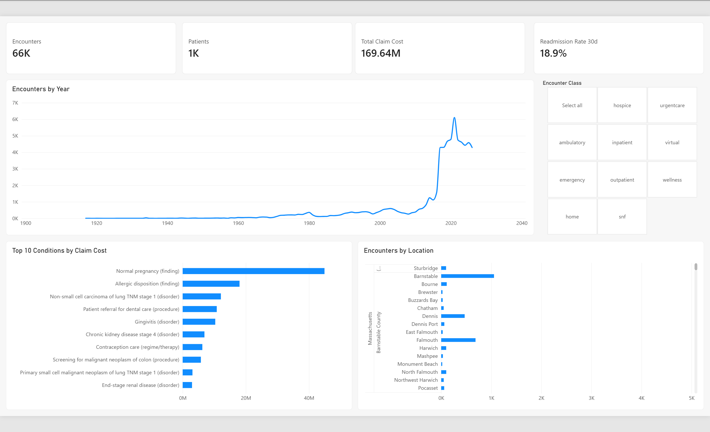
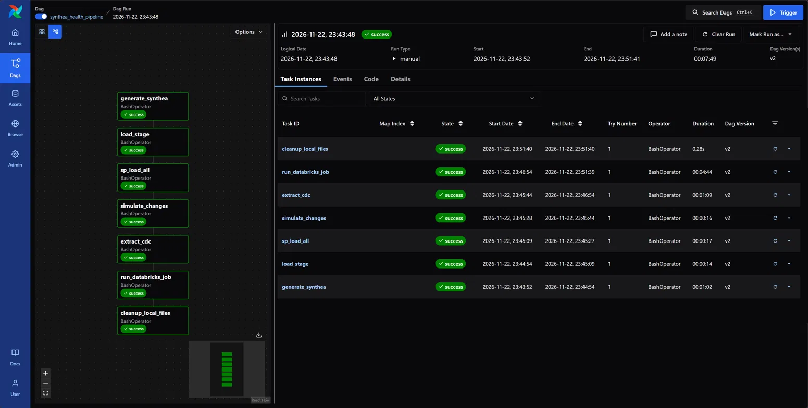
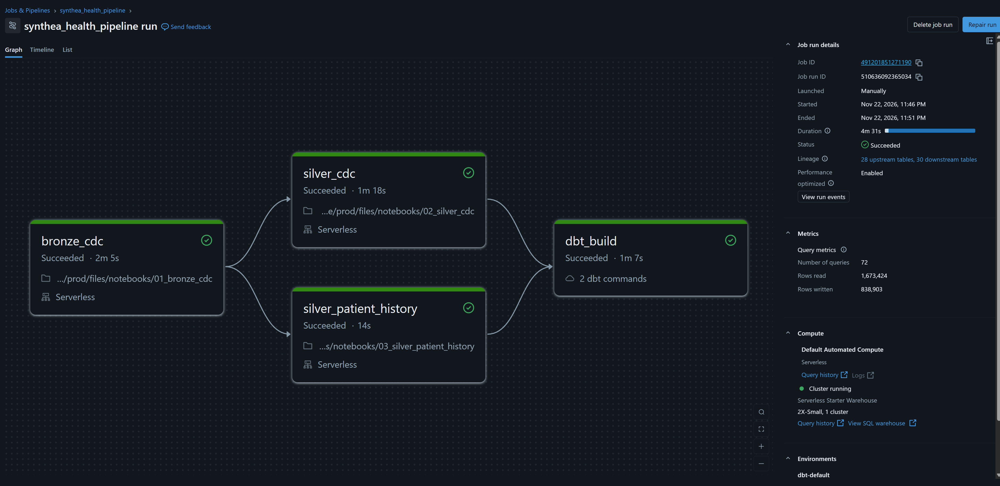

# synthea-health-pipeline

End-to-end healthcare ELT pipeline on synthetic patient data. SQL Server is the source system, CDC captures every change, Databricks processes it through bronze, silver and gold, dbt builds the marts, Airflow orchestrates the run, and Power BI shows the results.



## Pipeline flow

```mermaid
flowchart LR
    subgraph LOCAL["Local machine"]
        SYN["Synthea<br/>CSV export, fixed seed"]
        LOAD["loader/load_stage.py"]
        subgraph SQL["SQL Server: SyntheaHealth"]
            STG["stage tables"]
            MERGE["stage.spLoad_All<br/>merge changed rows only"]
            CORE["ref + clinical tables"]
            SIM["stage.spSimulate_Changes<br/>inserts, updates, deletes"]
            CDC["CDC change tables<br/>10 tables, 30-day retention"]
            WM["etl.CdcWatermark<br/>last LSN read"]
        end
        EXT["extractor/extract_cdc.py<br/>snapshot + net changes"]
    end

    subgraph DBX["Databricks: synthea catalog"]
        VOL["landing.cdc volume<br/>Parquet per capture instance"]
        BR["bronze<br/>Auto Loader tables"]
        SC["silver_cdc<br/>changes applied, deduped"]
        SPH["silver_patient_history<br/>SCD2"]
        GOLD["gold<br/>dbt marts + tests"]
        WH["SQL warehouse"]
    end

    PBI["Power BI dashboard"]

    SYN --> LOAD --> STG --> MERGE --> CORE
    SIM --> CORE
    CORE -->|"SQL Server Agent capture job"| CDC
    CDC --> EXT
    WM <--> EXT
    EXT --> VOL --> BR
    BR --> SC
    BR --> SPH
    SC --> GOLD
    SPH --> GOLD
    GOLD --> WH -->|"Import"| PBI
```



Airflow runs everything above as one DAG of 7 tasks: generate_synthea, load_stage, sp_load_all, simulate_changes, extract_cdc, run_databricks_job, cleanup_local_files. Local CSVs are only deleted after the Databricks job succeeds, so a failed run can be retried.



The Databricks part is a bundle-deployed job:



## Stack

- SQL Server: source database, stored procedures, CDC, role-based security, dynamic data masking
- Python: Synthea loader, CDC extractor, orchestration scripts
- Databricks (Free Edition, serverless): Unity Catalog, Auto Loader, PySpark, Asset Bundles
- dbt: gold star schema and data tests
- Airflow 3: single container, manual trigger
- Power BI: dashboard on the gold marts

## SQL Server design

- `stage` holds raw loads. `ref` and `clinical` hold the merged data. Consumers read the `api` views, never the tables.
- `ref.Location` is a hierarchy (state, county, city) with `ID`, `ID_Parent`, `Path`, `Level` and `HasChildren`, kept up to date by `ref.spLocation_UpdateHierarchy`.
- Role-based security: four roles (Developer, Clinician, Loader, Extractor) built on schema grants, each with its own least-privilege login. Dynamic data masking hides patient details, and the extractor can unmask `BirthDate` only, because silver needs it.
- Data minimization: SSN, driver's license and passport numbers are never loaded. There is no stage column for them.
- Merges write only rows that actually changed (`EXISTS ... EXCEPT`), so CDC never logs fake updates.
- CDC is enabled on 10 tables with 30-day retention. The extractor tracks the last LSN it read in `etl.CdcWatermark`, so each run only pulls new changes.
- `stage.spSimulate_Changes` makes random inserts, updates and deletes so every run has real CDC traffic to process.
- No secrets in the repo: passwords and the Databricks token live in user environment variables.

## Databricks layers

| Schema | Contents |
|---|---|
| `landing` | `cdc` volume with Parquet from the extractor, one folder per capture instance |
| `bronze` | Auto Loader tables, one per capture instance |
| `silver` | CDC applied and deduped, plus SCD2 patient history |
| `gold` | dbt marts: 7 dimensions (code, date, location, organization, patient, payer, provider) and 2 facts (encounters, conditions) |

dbt tests cover keys and relationships, plus a custom test that each patient has exactly one current version in the SCD2 dimension.

## Dashboard

Star model with 9 relationships. Cards for encounters, patients, total claim cost and 30-day readmission rate, encounters by year, top 10 conditions by claim cost, encounters by location (state, county, city drill-down) and an encounter class slicer.

Last full run: 1,000 Synthea patients, about 66K encounters, 838K rows written in Databricks, 7m 49s end to end.

Note on the encounters-by-year chart: the jump after 2016 is Synthea, not the pipeline. Synthea only exports about the last 10 years of detailed history by default, and the run uses a reference date of 2026-11-22.

## Running it

### Prerequisites

- SQL Server (local default instance) with SQL Server Agent
- Docker Desktop
- Databricks Free Edition workspace and the Databricks CLI with a configured profile
- Python 3 with a venv: `pip install -r requirements.txt`
- `synthea/synthea-with-dependencies.jar` from the [Synthea releases](https://github.com/synthetichealth/synthea/releases)

### Configure

The Databricks host, CLI profile and SQL warehouse ID are hardcoded for my workspace. Change them in:

- `databricks.yml`
- `resources/synthea.job.yml`
- `airflow/docker-compose.yml`
- `tools/dbsql.ps1`
- `tools/setup_databricks.ps1`

### One-time setup

1. Create the user environment variables (the login scripts read them):

```powershell
[Environment]::SetEnvironmentVariable('SYNTHEA_LOADER_PWD', '<password>', 'User')
[Environment]::SetEnvironmentVariable('SYNTHEA_EXTRACTOR_PWD', '<password>', 'User')
[Environment]::SetEnvironmentVariable('SYNTHEA_DATABRICKS_TOKEN', '<token>', 'User')
```

2. Enable TCP on SQL Server, from an admin PowerShell (Airflow in Docker reaches SQL Server over TCP on 1433):

```powershell
.\tools\enable_sql_tcp.ps1
```

3. Deploy the database and Databricks:

```powershell
.\tools\deploy_db.ps1
.\tools\setup_databricks.ps1
databricks bundle deploy --profile <your-profile>
```

### Run

```powershell
.\start.ps1
```

Starts SQL Server Agent, Docker and Airflow, then opens http://localhost:8081. Trigger `synthea_health_pipeline` from there. When done, run `.\stop.ps1`.

### Full reset

```powershell
.\reset.ps1
```

Drops and rebuilds the SQL Server database (including CDC and the watermark), wipes the Databricks schemas and the landing volume, starts everything and triggers one fresh DAG run.

Synthea runs with a fixed seed and reference date (`-s 42 -r 20261122 -p 1000`), so every reset produces the same data.

## Production note

Here the extractor runs on a laptop through Airflow. In a real deployment it would run on an always-on server close to the database (the self-hosted gateway pattern), so CDC is read on time and nothing depends on a personal machine being on.

## Repo layout

```
airflow/        Dockerfile, compose file, DAG
db/             SQL Server objects: tables, procs, views, security, CDC
dbt/            gold models and tests
extractor/      CDC extractor
loader/         Synthea CSV loader
notebooks/      bronze and silver notebooks
orchestration/  helpers to run procs and the Databricks job
powerbi/        dashboard
resources/      Databricks bundle resources (job, schemas, volume)
tools/          deploy and setup scripts
```